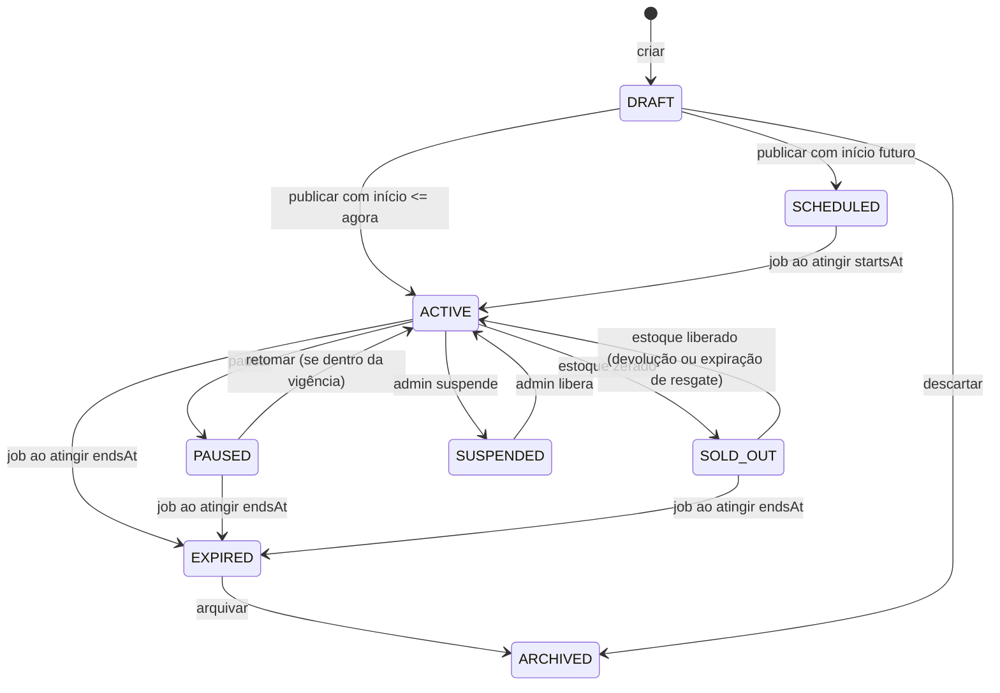
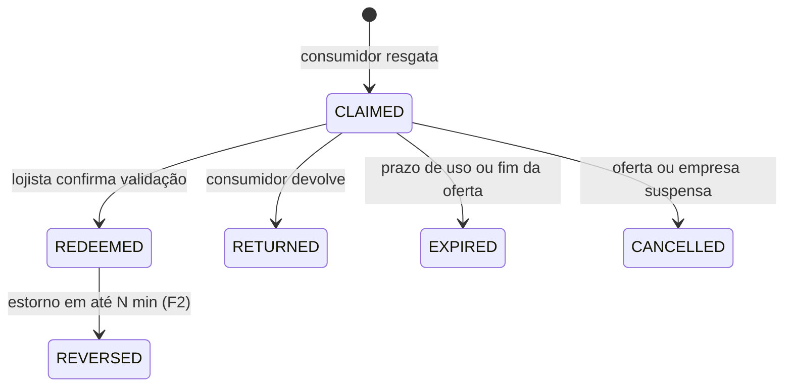
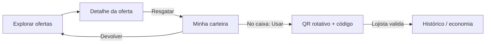
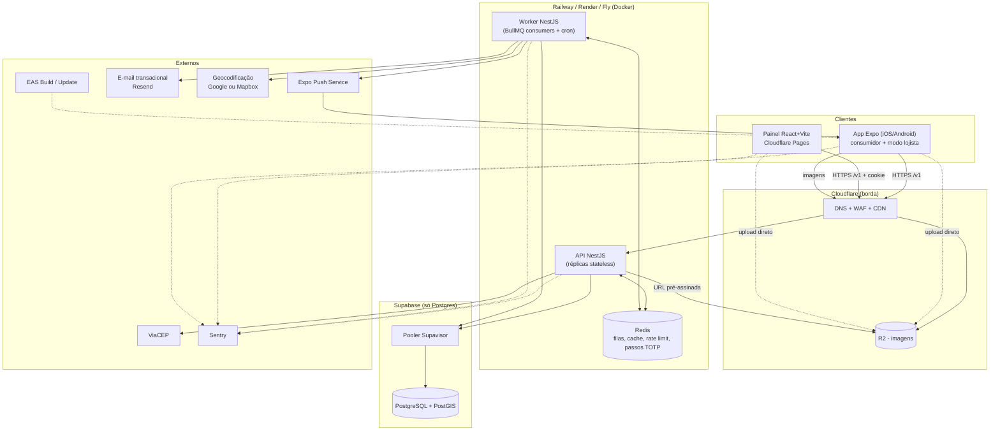
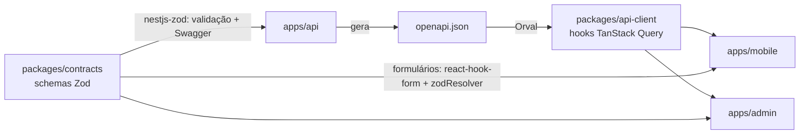
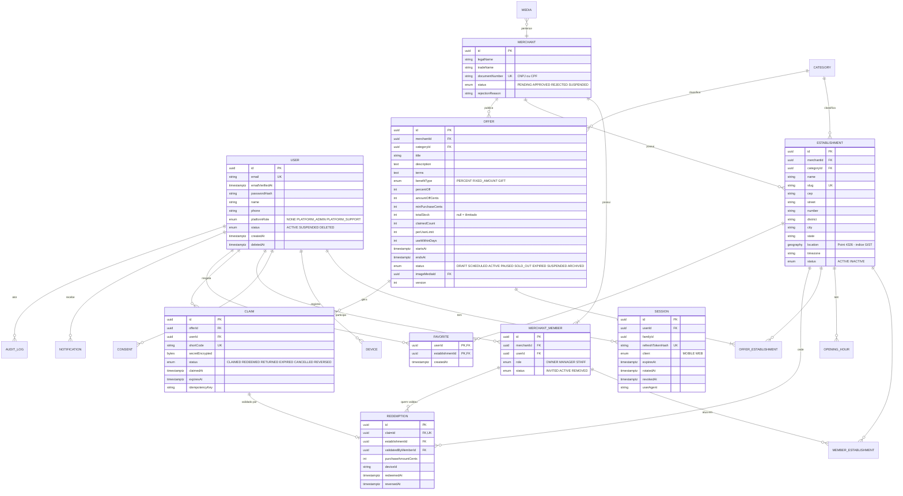
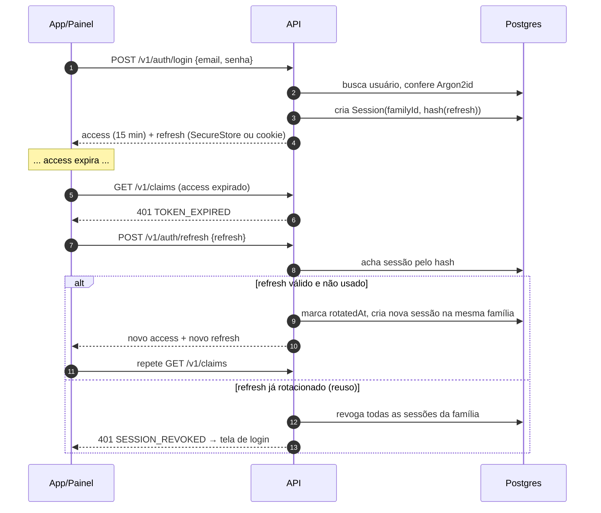
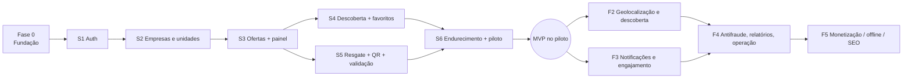

# UPON — Planejamento de Implementação

> Primeiro documento do repositório novo. Versão 0.1 (21/11/2026), **para revisão**. Nada foi implementado.
> Referência: `ANALISE_UPON.md` (análise do repositório antigo `alexlbnt/App_Upon`, usado só como consulta).

**Decisões já tomadas (não reabrir sem motivo novo):**

| Tema | Decisão |
|---|---|
| Validação no caixa | Pelo **mesmo app Expo**, em "modo lojista" para quem é membro de um estabelecimento |
| Offline | Validação **sempre online** no MVP |
| Backend | **NestJS em container contínuo** (Docker) em Railway, Render ou Fly |
| Banco | **Supabase usado só como Postgres gerenciado** (PostGIS + pooler). Supabase Auth **não** é usado |
| Auth | JWT + refresh token implementados **no NestJS** |
| Filas, jobs e cache | **Redis + BullMQ** |
| Borda | **Cloudflare**: DNS, CDN, WAF e **R2** para imagens |
| Painel web | **React + Vite (SPA)** com TanStack Router/Query e shadcn/ui, no **Cloudflare Pages**; sem SSR, sem regra de negócio no front |
| Portabilidade | Tudo em Docker + Postgres padrão, para poder migrar para AWS/GCP |

---

## Sumário

1. [Levantamento de requisitos](#1-levantamento-de-requisitos)
2. [Arquitetura](#2-arquitetura)
3. [Tecnologias e ADRs](#3-tecnologias-e-adrs)
4. [Plano de implementação](#4-plano-de-implementação)
5. [Dúvidas para o Alexandre](#5-dúvidas-para-o-alexandre)
6. [Lições do projeto antigo](#6-lições-do-projeto-antigo)

---

## 1. Levantamento de requisitos

### 1.1 Atores e perfis

| Ator | Descrição | Onde atua |
|---|---|---|
| **Visitante** *(faltava)* | Não logado; navega pelas ofertas | App |
| **Consumidor** | Conta pessoal; favorita, resgata e usa cupons | App |
| **Dono do estabelecimento** (`OWNER`) | Responsável pela empresa; gerencia unidades, ofertas, equipe e dados de cobrança | Painel + app (modo lojista) |
| **Gerente** (`MANAGER`) *(faltava)* | Gerencia ofertas e equipe de uma ou mais unidades, sem dados sensíveis da empresa | Painel + app |
| **Funcionário / caixa** (`STAFF`) | Só valida cupons nas unidades a que está vinculado | App (modo lojista) |
| **Administrador da plataforma** (`PLATFORM_ADMIN`) | Aprova empresas, modera ofertas, trata fraude, gerencia categorias | Painel (área admin) |
| **Suporte da plataforma** (`PLATFORM_SUPPORT`) *(faltava, fase 2)* | Consulta e ajuda sem poder destrutivo | Painel (área admin) |
| **Sistema** *(faltava)* | Jobs: expirar ofertas e resgates, enviar notificações, liberar estoque | Workers |

Uma mesma pessoa pode ser consumidora e membro de um ou mais estabelecimentos. O papel de lojista é um **vínculo** (`MerchantMember`), não um tipo de conta.

### 1.2 Requisitos funcionais

Legenda: **MVP** = obrigatório no MVP · **F2…F5** = fase posterior (ver §4.2).

#### Auth

| ID | Requisito | Fase |
|---|---|---|
| RF01 | Cadastro de consumidor com nome, e-mail, senha e aceite de termos e privacidade | MVP |
| RF02 | Verificação de e-mail por link ou código | MVP |
| RF03 | Login com e-mail e senha (app e painel) | MVP |
| RF04 | Renovação de sessão transparente (refresh token com rotação) | MVP |
| RF05 | Logout do dispositivo atual e "sair de todos os dispositivos" | MVP |
| RF06 | Recuperação de senha por e-mail | MVP |
| RF07 | Ver sessões e dispositivos ativos e revogar individualmente | F4 |
| RF08 | Login social Google e Apple | F3 (decisão D8) |
| RF09 | Exclusão de conta pelo próprio app (exigência Apple e Google) | MVP |

#### Usuários e perfil

| ID | Requisito | Fase |
|---|---|---|
| RF10 | Ver e editar perfil (nome, foto, telefone opcional) | MVP |
| RF11 | Preferências: cidade padrão, categorias de interesse, opt-in de notificações | MVP (cidade) / F3 (resto) |
| RF12 | Exportar meus dados (LGPD) | F4 |
| RF13 | Registro de consentimentos (termos, privacidade, marketing) com versão e data | MVP |

#### Estabelecimentos (empresa e unidades)

| ID | Requisito | Fase |
|---|---|---|
| RF14 | Solicitar cadastro de empresa: razão social, nome fantasia, CNPJ/CPF, responsável | MVP |
| RF15 | Admin aprova, reprova (com motivo) ou suspende a empresa | MVP |
| RF16 | Cadastrar unidades: endereço por CEP (ViaCEP), geocodificação lat/lng, telefone, categoria, fotos | MVP |
| RF17 | Horários de funcionamento por dia, com status "aberto agora" calculado | MVP |
| RF18 | Convidar membros por e-mail com papel (`MANAGER`/`STAFF`) e unidades vinculadas | MVP |
| RF19 | Remover membro ou alterar seu papel (efeito imediato nas permissões) | MVP |
| RF20 | Página pública da unidade: dados, mapa estático, ofertas ativas | MVP |
| RF21 | Várias empresas por usuário e várias unidades por empresa | MVP (modelo) |

#### Ofertas e cupons

| ID | Requisito | Fase |
|---|---|---|
| RF22 | Criar oferta em rascunho: título, descrição, regras, imagem, categoria | MVP |
| RF23 | Tipo de benefício: **percentual**, **valor fixo** ou **brinde/condição** (texto) | MVP |
| RF24 | Configurar vigência (início e fim), estoque total (opcional), limite por usuário, prazo de uso após resgate e compra mínima (informativa) | MVP |
| RF25 | Escolher as unidades onde a oferta vale | MVP |
| RF26 | Publicar agora ou agendar; pausar, retomar, encerrar; duplicar oferta | MVP (duplicar F2) |
| RF27 | Listagem pública com filtros por cidade, categoria e estabelecimento, e busca por texto | MVP |
| RF28 | Detalhe público da oferta com regras, unidades, validade e estoque restante | MVP |
| RF29 | Ofertas "perto de mim" por raio, ordenadas por distância | F2 |
| RF30 | Mapa de estabelecimentos com ofertas | F2 |
| RF31 | Destaques e banners curados pelo admin | F2 |

#### Resgate e carteira

| ID | Requisito | Fase |
|---|---|---|
| RF32 | **Resgatar** oferta: o cupom vai para a carteira (exige login) | MVP |
| RF33 | Carteira agrupada por estabelecimento e ordenada por vencimento | MVP |
| RF34 | Devolver um cupom resgatado (libera o estoque) | MVP |
| RF35 | **Usar no caixa**: QR rotativo + código curto digitável | MVP |
| RF36 | A tela do QR fecha sozinha e confirma quando o cupom é validado | MVP (polling) / F3 (tempo real) |
| RF37 | Histórico de cupons usados, expirados e devolvidos, com economia estimada | MVP |

#### Validação (modo lojista)

| ID | Requisito | Fase |
|---|---|---|
| RF38 | Alternar para o modo lojista e escolher a unidade de trabalho | MVP |
| RF39 | Escanear o QR do cliente com a câmera | MVP |
| RF40 | Digitar o código curto quando a câmera falhar | MVP |
| RF41 | **Pré-visualizar** (oferta, regras, primeiro nome do cliente) e **confirmar** a validação | MVP |
| RF42 | Informar o valor da compra (opcional), para relatórios | MVP |
| RF43 | Histórico de validações da unidade (funcionário vê as suas; gerente vê todas) | MVP |
| RF44 | Estornar uma validação em até N minutos, com motivo (`MANAGER`/`OWNER`) | F2 |

#### Favoritos

| ID | Requisito | Fase |
|---|---|---|
| RF45 | Favoritar e desfavoritar estabelecimento (unidade) | MVP |
| RF46 | Lista de favoritos com ofertas ativas de cada um | MVP |
| RF47 | Aviso de nova oferta de um favorito | F3 |

#### Painel web do estabelecimento

| ID | Requisito | Fase |
|---|---|---|
| RF48 | Login no painel e escolha da empresa (se houver várias) | MVP |
| RF49 | Dashboard: ofertas ativas, resgates, validações, taxa de uso, por período e unidade | MVP (básico) / F4 (completo) |
| RF50 | Gestão de ofertas (RF22–RF26) | MVP |
| RF51 | Gestão de unidades e equipe (RF16–RF19) | MVP |
| RF52 | Relatório de validações com exportação CSV | F2 |
| RF53 | Log de auditoria da empresa (quem fez o quê) | F4 |

#### Administração da plataforma

| ID | Requisito | Fase |
|---|---|---|
| RF54 | Fila de aprovação de empresas | MVP |
| RF55 | Gerenciar categorias | MVP |
| RF56 | Suspender oferta, empresa ou usuário, com motivo | MVP |
| RF57 | Painel de sinais de fraude (validações suspeitas, contas em série) | F4 |
| RF58 | Métricas globais (usuários, ofertas, resgates, validações por cidade) | F4 |

#### Notificações

| ID | Requisito | Fase |
|---|---|---|
| RF59 | E-mails transacionais: verificação, recuperação de senha, convite de equipe, aprovação de empresa | MVP |
| RF60 | Push "cupom validado" | F3 |
| RF61 | Push "seu cupom vence em 24 h" | F3 |
| RF62 | Central de notificações no app e preferências por tipo | F3 |

### 1.3 Requisitos não funcionais

| ID | Categoria | Requisito |
|---|---|---|
| RNF01 | Segurança | Senhas com **Argon2id**; nunca em log |
| RNF02 | Segurança | Access token JWT de **15 min**; refresh token opaco de **30 dias** com rotação e detecção de reuso (ver §2.6) |
| RNF03 | Segurança | Tokens no app só no **SecureStore** (Keychain/Keystore). No painel, refresh token em **cookie httpOnly, Secure, SameSite=Strict**, com access token só em memória |
| RNF04 | Segurança | Rate limit por IP e por usuário em login, cadastro, resgate e validação (Redis) |
| RNF05 | Segurança | Segredos só em variáveis de ambiente ou cofre do provedor; `.env` nunca versionado; varredura de segredos no CI |
| RNF06 | Segurança | Autorização **no backend** em toda rota (guard de autenticação + política de domínio). O front só esconde botões |
| RNF07 | Segurança | Cloudflare WAF + HTTPS obrigatório; CORS restrito aos domínios do painel; Helmet |
| RNF08 | Desempenho | p95 < 300 ms nas leituras públicas e < 500 ms na validação, medido na API |
| RNF09 | Desempenho | Listagens com paginação por cursor; imagens servidas pela CDN em tamanhos otimizados |
| RNF10 | Escalabilidade | API **stateless** (estado em Postgres e Redis), escala horizontal por réplicas; workers separados da API |
| RNF11 | Disponibilidade | Meta de 99,5 % no MVP; health checks (`/health/live`, `/health/ready`); backups diários com PITR do Supabase |
| RNF12 | Portabilidade | Só Postgres padrão e PostGIS, sem recursos proprietários do Supabase; imagem Docker única para API e worker |
| RNF13 | LGPD | Minimização (CPF só se for decidido, D9); finalidade declarada; consentimento registrado; exclusão e exportação de dados; localização **não** armazenada em histórico |
| RNF14 | LGPD | Logs e eventos de monitoramento com dados pessoais mascarados; retenção definida (por exemplo, logs 30 dias, auditoria 5 anos) |
| RNF15 | Acessibilidade | WCAG 2.1 AA como meta: rótulos para leitor de tela, contraste ≥ 4,5:1, alvos ≥ 44 pt, suporte a fonte dinâmica |
| RNF16 | Observabilidade | Sentry em app, painel e API; logs JSON estruturados (pino) com `requestId`; rastreamento OpenTelemetry na F4 |
| RNF17 | Observabilidade | Alertas de erro, latência e fila parada; uptime monitor externo |
| RNF18 | Offline | App mostra a carteira e o QR **sem internet** (o código rotativo é gerado no aparelho, ver §2.7). A validação do lojista exige internet |
| RNF19 | Offline | Cache persistido das últimas ofertas e favoritos para abrir o app sem rede (somente leitura) |
| RNF20 | Qualidade | CI bloqueia merge sem lint, checagem de tipos e testes verdes; cobertura ≥ 80 % nas regras de domínio (resgate, validação, auth) |
| RNF21 | Compatibilidade | iOS e Android nas versões suportadas pelo SDK Expo escolhido; painel nos 2 últimos Chrome, Edge, Safari e Firefox |
| RNF22 | Internacionalização | pt-BR no lançamento, com textos centralizados (preparado para i18n); dinheiro em **centavos inteiros**; datas em UTC no banco e `America/Sao_Paulo` na exibição |

### 1.4 Regras de negócio

#### Ciclo de vida da oferta



#### Ciclo de vida do resgate (cupom na carteira)



#### Regras

| ID | Regra |
|---|---|
| **Oferta** | |
| RN01 | Só empresa **APROVADA** e **ativa** publica ofertas |
| RN02 | Oferta publicada precisa de: título, benefício, ≥ 1 unidade, `startsAt` < `endsAt`, imagem |
| RN03 | Após o primeiro resgate, **não podem mudar**: benefício, unidades (só acrescentar), limite por usuário (só aumentar) e estoque (só aumentar). Texto e imagem podem mudar |
| RN04 | Percentual entre 1 e 100; valor fixo > 0, em centavos |
| RN05 | Estoque é opcional (`null` = ilimitado). `claimedCount` nunca passa de `totalStock` (atualização atômica no banco) |
| RN06 | Oferta `SOLD_OUT` aparece na listagem como esgotada só por 24 h; depois sai das listagens |
| **Resgate** | |
| RN07 | Resgatar exige conta com **e-mail verificado** |
| RN08 | Limite por usuário (padrão 1): conta resgates `CLAIMED` + `REDEEMED` do usuário naquela oferta |
| RN09 | O resgate **reserva** uma unidade do estoque (decisão D6) |
| RN10 | Prazo de uso: o resgate expira em `min(claimedAt + useWithinDays, offer.endsAt)` |
| RN11 | Resgate expirado ou devolvido **libera** o estoque (job ou ação) |
| RN12 | Máximo de **N resgates ativos** por consumidor (por exemplo, 20), para evitar acúmulo de estoque |
| RN13 | Resgate é idempotente: o mesmo `Idempotency-Key` não gera dois cupons |
| **Validação e antifraude** | |
| RN14 | Cada resgate tem um **segredo próprio** (`claimSecret`, 160 bits), entregue só ao dono e guardado no SecureStore |
| RN15 | O QR mostra um **código rotativo** derivado do segredo (TOTP, janela de 30 s). Um print vale no máximo ~60 s |
| RN16 | O servidor aceita o passo atual ±1 e **marca o passo como usado** (Redis, TTL 90 s): o mesmo código nunca vale duas vezes |
| RN17 | A validação é **de uso único**: índice único em `redemption.claimId` e transição `CLAIMED → REDEEMED` na mesma transação |
| RN18 | Só valida quem é membro **ativo** com papel `STAFF`, `MANAGER` ou `OWNER` de uma **unidade aceita** pela oferta |
| RN19 | Validação em duas etapas: *preview* (bloqueia o resgate por 60 s para aquele funcionário) → *confirm* |
| RN20 | Membro não valida cupom **da própria conta** de consumidor |
| RN21 | Tela do QR com bloqueio de captura de tela (Android) e aviso visual animado (iOS), para dificultar print |
| RN22 | Sinais de fraude registrados (F4 bloqueia): muitas validações de um mesmo consumidor em pouco tempo, muitos erros de código por funcionário, contas criadas em série no mesmo aparelho |
| RN23 | Toda validação registra unidade, funcionário, data e hora, valor da compra (opcional) e aparelho |
| **Contas e papéis** | |
| RN24 | Toda empresa tem **pelo menos um** `OWNER`; o último não pode sair nem ser removido |
| RN25 | Remover um membro revoga a permissão de validar **imediatamente**: a permissão é checada no banco a cada validação, não só no token |
| RN26 | Excluir conta: anonimiza os resgates (mantém estatística), apaga dados pessoais e revoga sessões. Dono único precisa transferir a empresa antes |
| RN27 | Favoritos são por **unidade**; favoritar não exige verificação de e-mail |

### 1.5 Carrinho × carteira

**O carrinho não faz sentido.** Não há compra, pagamento nem soma de itens no app: o desconto é aplicado no caixa do comércio. O app antigo já tinha percebido isso e trocou o carrinho pela carteira. O fluxo recomendado é:



- **Um QR por cupom** no MVP. O QR do app antigo, com "todos os cupons da carteira", mistura lojas diferentes e complica limites e auditoria. "Usar vários cupons da mesma loja de uma vez" pode entrar na F2.
- Se no futuro houver **cupom pago** (D3), entra um fluxo de checkout próprio, ainda sem carrinho.

### 1.6 Histórias de usuário do MVP

| ID | História | Critérios de aceite |
|---|---|---|
| US01 | Como **visitante**, quero ver ofertas da minha cidade sem criar conta, para decidir se vale a pena me cadastrar | • Lista abre sem login, filtrada pela cidade escolhida · • Filtro por categoria e busca por texto · • Ao tocar "Resgatar", o app pede login e volta para a oferta depois |
| US02 | Como **consumidor**, quero criar conta e entrar com e-mail e senha | • Senha com no mínimo 8 caracteres e verificação de vazamento (opcional) · • E-mail de verificação enviado · • Sessão continua após fechar o app · • Erro genérico para credencial inválida |
| US03 | Como **consumidor**, quero resgatar um cupom para a minha carteira | • Só com e-mail verificado (RN07) · • Respeita limite por usuário e estoque (RN05, RN08) · • Tocar duas vezes não gera dois cupons (RN13) · • O cupom aparece na carteira com a data de vencimento |
| US04 | Como **consumidor**, quero mostrar o QR no caixa mesmo sem sinal | • QR e código curto aparecem sem internet (RNF18) · • O código muda a cada 30 s com contador visível · • Print bloqueado no Android · • Com internet, a tela confirma "Cupom usado" em até 3 s após a validação |
| US05 | Como **funcionário**, quero validar o cupom do cliente em poucos segundos | • Modo lojista mostra só as unidades onde sou membro · • Leitura do QR ou digitação do código · • Preview com oferta, regras e primeiro nome do cliente · • Confirmação em um toque · • Erros claros: expirado, já usado, outra loja, código inválido |
| US06 | Como **funcionário**, quero ter certeza de que o mesmo cupom não passa duas vezes | • Segunda confirmação do mesmo resgate devolve "já utilizado em DD/MM HH:mm na unidade X" · • Código antigo (> 60 s) é recusado |
| US07 | Como **dono**, quero cadastrar minha empresa e minhas unidades | • Formulário com CNPJ/CPF e responsável · • Endereço preenchido pelo CEP e localização confirmada no mapa · • Status "Em análise" até a aprovação do admin · • E-mail ao aprovar ou reprovar |
| US08 | Como **dono/gerente**, quero criar e publicar ofertas pelo painel | • Rascunho salvo a qualquer momento · • Pré-visualização igual ao app · • Publicar ou agendar · • Regras de RN02–RN04 validadas no painel **e** na API |
| US09 | Como **dono**, quero convidar meu caixa para validar cupons | • Convite por e-mail com papel e unidades · • O convidado aceita com conta nova ou existente · • Remover o membro bloqueia a validação na hora (RN25) |
| US10 | Como **dono/gerente**, quero ver quantos cupons foram resgatados e usados | • Cards por período (7/30 dias) e unidade · • Lista das últimas validações com funcionário e horário |
| US11 | Como **admin**, quero aprovar empresas antes de elas publicarem | • Fila com dados e documentos · • Aprovar ou reprovar com motivo · • Empresa reprovada não publica (RN01) |
| US12 | Como **consumidor**, quero excluir minha conta | • Opção no perfil com confirmação · • Sessões revogadas e dados pessoais apagados ou anonimizados (RN26) |

---

## 2. Arquitetura

### 2.1 Visão geral



- **Uma imagem Docker, dois processos**: `api` (HTTP) e `worker` (filas e cron). Escalam separadamente.
- O app e o painel **nunca** falam direto com o banco nem com o R2 sem URL pré-assinada.

### 2.2 Monorepo

**Recomendação: monorepo com pnpm workspaces + Turborepo** (ADR-001).

```
upon/
├── apps/
│   ├── mobile/            # Expo (Expo Router)
│   ├── admin/             # Painel React + Vite (estabelecimentos + admin da plataforma)
│   └── api/               # NestJS (API + worker, entradas separadas)
├── packages/
│   ├── contracts/         # Schemas Zod, enums, tipos e códigos de erro (fonte única)
│   ├── api-client/        # Cliente + hooks TanStack Query gerados do OpenAPI (Orval)
│   ├── domain-rules/      # Funções puras compartilhadas (ex.: cálculo de status, formatação de desconto, TOTP)
│   ├── design-tokens/     # Cores, espaçamentos e tipografia (Tailwind web + NativeWind mobile)
│   └── config/            # tsconfig, ESLint, Prettier, Vitest base
├── infra/
│   ├── docker/            # Dockerfile da API, docker-compose de dev (postgis, redis, minio)
│   └── scripts/
├── docs/
│   ├── PLANEJAMENTO_UPON.md
│   ├── adr/               # ADRs numerados
│   └── api/               # OpenAPI exportado (artefato)
├── .github/workflows/
├── turbo.json  pnpm-workspace.yaml  package.json
└── README.md
```

**Fluxo de contrato**



Uma regra de validação muda em **um** lugar e vale para API, app e painel. O CI falha se o `openapi.json` gerado estiver diferente do versionado.

*Alternativa considerada:* repositórios separados. Rejeitada porque obriga a publicar pacotes de contrato e versioná-los à parte, e é fácil o app e a API saírem de sincronia (o problema M3 do projeto antigo).

### 2.3 Backend

**Monólito modular** (ADR-002): um deploy, módulos com fronteiras claras, prontos para virar serviços se um dia for preciso.

```
apps/api/src/
├── main.ts / worker.ts            # duas entradas
├── app.module.ts
├── common/                        # filtros de erro (Problem Details), guards, interceptors, decorators, paginação
├── infra/                         # prisma, redis, bullmq, r2, mailer, push, logger, config (validado com Zod)
└── modules/
    ├── auth/          # login, refresh, sessões, recuperação de senha, verificação de e-mail
    ├── users/         # perfil, preferências, consentimentos, exclusão
    ├── merchants/     # empresa, aprovação, membros, convites
    ├── establishments/# unidades, endereço, geolocalização, horários
    ├── catalog/       # categorias
    ├── offers/        # ofertas, ciclo de vida, listagem pública, busca
    ├── claims/        # resgate, carteira, devolução, expiração
    ├── redemptions/   # preview/confirm, TOTP, antifraude
    ├── favorites/
    ├── media/         # URLs pré-assinadas R2, pós-processamento
    ├── notifications/ # e-mail, push, tokens de dispositivo
    ├── reports/       # métricas do painel
    └── admin/         # moderação, fila de aprovação
```

**Camadas dentro de cada módulo**

| Camada | Pasta | Responsabilidade | Depende de |
|---|---|---|---|
| Interface | `http/` (controllers), `jobs/` (processors) | HTTP, auth guard, validação Zod, mapeamento para DTO | Aplicação |
| Aplicação | `application/` (casos de uso) | Orquestra a transação, chama repositórios e políticas, publica eventos | Domínio + portas |
| **Domínio** | `domain/` | **Regras de negócio puras**: entidades, máquinas de estado, políticas (`canValidate`, `canClaim`), erros de domínio. Sem Nest, sem Prisma | Nada |
| Infraestrutura | `infra/` | Repositórios Prisma, SQL de geolocalização, adaptadores (R2, e-mail, push) | Prisma, SDKs |

- Regras como RN05–RN20 ficam em `domain/` e são testadas sem banco.
- Efeitos colaterais (push, e-mail, auditoria) saem por **eventos de domínio**, entregues ao BullMQ **depois do commit** (padrão outbox simples a partir da F3).
- Erros de domínio têm `code` estável (`CLAIM_LIMIT_REACHED`, `REDEMPTION_CODE_EXPIRED`…) definido em `packages/contracts`.

### 2.4 Mobile

```
apps/mobile/
├── app/                              # Expo Router (só rotas e layouts)
│   ├── _layout.tsx                   # providers, splash, carregamento da sessão
│   ├── (public)/                     # visitante: explorar, detalhe de oferta, unidade
│   ├── (auth)/                       # login, cadastro, recuperar senha
│   ├── (consumer)/(tabs)/            # explorar · favoritos · carteira · perfil
│   │   └── wallet/[claimId]/use.tsx  # tela do QR
│   └── (merchant)/                   # modo lojista: escolher unidade · escanear · histórico
├── src/
│   ├── features/
│   │   ├── auth/  offers/  wallet/  favorites/  establishments/  merchant-validation/  profile/
│   │   │   └── components/ hooks/ screens/ utils/
│   ├── shared/   ui/ (componentes base) · lib/ · i18n/
│   └── session/  # tokenStore (SecureStore), refresh single-flight, sessionStore (Zustand)
└── app.config.ts                     # config por ambiente (EXPO_PUBLIC_API_URL etc.)
```

| Tipo de estado | Ferramenta | Exemplos |
|---|---|---|
| Estado do servidor | **TanStack Query** (hooks gerados), com cache persistido | ofertas, carteira, favoritos, perfil |
| Sessão | Zustand + SecureStore | usuário atual, papéis, unidade ativa do lojista |
| Preferências locais | Zustand `persist` (MMKV) | cidade, último modo usado |
| Formulários | react-hook-form + Zod | cadastro, login |
| Segredos de resgate | SecureStore | `claimSecret` de cada cupom ativo |

**Navegação e sessão**

- Expo Router com **`Stack.Protected`**: o grupo `(consumer)` exige sessão; o grupo `(merchant)` exige sessão **e** algum vínculo de membro. A permissão real continua sendo checada na API (RNF06).
- Ao abrir o app: splash nativo → lê o refresh token do SecureStore → `POST /auth/refresh` → carrega `/me` (com vínculos) → libera as rotas.
- Sem rede ao abrir: usa o último `/me` em cache e mostra a carteira em modo somente leitura.
- O cliente HTTP renova o token **uma vez só** para requisições paralelas (single-flight) e repete a chamada; se o refresh falhar, faz logout local.

### 2.5 Modelo de dados



Tabelas auxiliares fora do diagrama: `CATEGORY`, `OPENING_HOUR`, `OFFER_ESTABLISHMENT`, `MEMBER_ESTABLISHMENT`, `MEDIA` (chave no R2, tipo, dimensões), `DEVICE` (token de push), `CONSENT`, `NOTIFICATION`, `INVITATION`, `AUDIT_LOG`, `FRAUD_SIGNAL` (F4).

**Pontos importantes**

- **Multi-estabelecimento**: `Merchant` (empresa) → N `Establishment` (unidades). A oferta é da empresa e vale nas unidades marcadas em `OFFER_ESTABLISHMENT`. O funcionário é vinculado à empresa e às unidades em que pode validar.
- **Geolocalização**: `location geography(Point,4326)` com índice GIST desde o MVP. A consulta "perto de mim" (F2) usa `ST_DWithin` e `ST_Distance`. A distância **não** é gravada (erro do projeto antigo).
- **Integridade no banco**: `UNIQUE(redemption.claimId)`, `CHECK(claimedCount <= totalStock)`, `UNIQUE(merchantMember.merchantId, userId)` e índice parcial para "resgates ativos por usuário e oferta".
- **Dinheiro** em centavos (`int`), **datas** em `timestamptz` (UTC), **ids** UUID v7 (ordenáveis).
- `version` na oferta para *optimistic locking* nas edições pelo painel.
- O `claimSecret` é cifrado em repouso (AES-GCM, chave fora do banco).

### 2.6 Autenticação e permissões

| Item | Decisão |
|---|---|
| Access token | JWT **ES256**, 15 min, com `sub`, `sid` (sessão), `platformRole` e `kid` para rotação de chave. **Não** leva os papéis de lojista (podem mudar a qualquer momento) |
| Refresh token | Valor **opaco aleatório** de 256 bits; o banco guarda só o **hash** (SHA-256); 30 dias; **rotação a cada uso** |
| Detecção de reuso | Se um refresh já rotacionado for apresentado de novo, **toda a família** (`familyId`) é revogada e o usuário precisa entrar de novo |
| Mobile | Os dois tokens no **SecureStore**; refresh no corpo de `POST /v1/auth/refresh` |
| Painel | Refresh em cookie `__Host-` httpOnly, Secure, SameSite=Strict, no domínio da API; access token **só em memória**; proteção CSRF com checagem de `Origin` + cabeçalho próprio |
| Senha | Argon2id; bloqueio progressivo após falhas (Redis) |
| Autorização | 1) `JwtAuthGuard` global (rotas públicas marcadas com `@Public()`); 2) `PlatformRoleGuard` para a área admin; 3) **políticas de domínio** no caso de uso (`MerchantPolicy.can(user, 'offer:publish', merchantId)`), consultando `MerchantMember` no banco |



**Matriz de permissões (resumo)**

| Ação | Consumidor | STAFF | MANAGER | OWNER | PLATFORM_ADMIN |
|---|:-:|:-:|:-:|:-:|:-:|
| Resgatar e usar cupom | ✅ | ✅ (como consumidor) | ✅ | ✅ | ✅ |
| Validar cupom na unidade vinculada | — | ✅ | ✅ | ✅ | — |
| Criar, editar e publicar ofertas | — | — | ✅ | ✅ | suspender |
| Gerenciar unidades | — | — | unidades vinculadas | ✅ | suspender |
| Gerenciar equipe | — | — | só `STAFF` | ✅ | — |
| Dados da empresa e transferência | — | — | — | ✅ | aprovar/suspender |
| Relatórios | só os próprios | só os próprios | unidades vinculadas | ✅ | global |

### 2.7 Validação do cupom por QR Code

**Ideia central:** o QR não leva um token emitido na hora pelo servidor. Ele leva um **código rotativo tipo TOTP**, gerado **no aparelho do consumidor** a partir do segredo daquele resgate. Isso atende a "uso único + expiração curta + assinatura + anti-print" e **funciona com o consumidor sem sinal** dentro da loja (RNF18), mantendo a validação online no lojista, como decidido (ADR-008).

- **Payload do QR:** `UPON1.<claimShortCode>.<totp8>`, por exemplo `UPON1.K7Q2MX.48201937`
- **Código digitável de reserva:** `K7Q2MX` + 6 dígitos do TOTP
- **TOTP:** HMAC-SHA1 (RFC 6238) com o `claimSecret`, passo de 30 s, 8 dígitos

```mermaid
sequenceDiagram
    autonumber
    actor C as Consumidor (app)
    participant API
    participant R as Redis
    participant DB as Postgres
    actor F as Funcionário (app, modo lojista)

    Note over C,API: Resgate (online)
    C->>API: POST /v1/offers/{id}/claims (Idempotency-Key)
    API->>DB: tx: valida RN07/RN08/RN12, incrementa claimedCount (atômico), cria Claim + segredo
    API-->>C: claimId, shortCode, claimSecret (uma única vez)
    C->>C: guarda claimSecret no SecureStore

    Note over C,F: No caixa (consumidor pode estar offline)
    C->>C: gera TOTP a cada 30 s e mostra QR + contador
    F->>F: escaneia o QR (expo-camera)
    F->>API: POST /v1/redemptions/preview {qr, establishmentId}
    API->>DB: carrega Claim + Offer + vínculo do funcionário
    API->>API: confere status, validade, unidade aceita, RN18, RN20 e TOTP (passo ±1)
    API->>R: SET passo usado + lock do claim para o funcionário (NX, TTL)
    API-->>F: previewId + oferta, regras e primeiro nome do cliente
    F->>API: POST /v1/redemptions/confirm {previewId, purchaseAmountCents?} (Idempotency-Key)
    API->>DB: tx: UPDATE claim SET status=REDEEMED WHERE status=CLAIMED; INSERT redemption (UNIQUE claimId); audit
    API-->>F: ✅ validado (dados para aplicar o desconto)
    API->>R: enfileira "claim.redeemed" (push F3)
    C->>API: (se online) polling GET /v1/claims/{id} a cada 2 s
    API-->>C: status REDEEMED → tela "Cupom usado"
```

| Ameaça | Mitigação |
|---|---|
| Print ou foto do QR enviado a outra pessoa | Código vale ~60 s (passo ±1); bloqueio de captura de tela; e o resgate é de uso único |
| Reaproveitar o mesmo código | Passo TOTP marcado como usado no Redis (RN16) |
| Validar duas vezes (dois caixas ao mesmo tempo) | Lock no preview + `UPDATE ... WHERE status='CLAIMED'` + `UNIQUE(claimId)` |
| QR forjado | Sem o `claimSecret` não há TOTP válido; o segredo só sai do servidor uma vez, para o dono, por TLS |
| Funcionário de outra loja | Vínculo membro ↔ unidade ↔ oferta checado no banco a cada validação (RN18, RN25) |
| Funcionário validando os próprios cupons | RN20, mais sinal de fraude |
| Força bruta no código digitável | Rate limit por funcionário e por unidade; bloqueio após N erros; alerta |
| Aparelho do consumidor comprometido | Risco aceito: o segredo vale só para um cupom de uso único dele mesmo |

### 2.8 Contrato da API

| Item | Padrão |
|---|---|
| Estilo | **REST + JSON**, recursos no plural, ações explícitas quando necessário (`/redemptions/preview`, `/redemptions/confirm`) |
| Versionamento | Prefixo de URL **`/v1`**. Mudança incompatível → `/v2` convivendo pelo tempo de atualização do app (apps antigos ficam instalados) |
| Versão mínima do app | Cabeçalho `X-App-Version`; a API responde `426 UPGRADE_REQUIRED` abaixo da mínima |
| Erros | **RFC 9457 Problem Details**: `{ type, title, status, detail, code, errors[] }`, com `code` estável vindo de `packages/contracts` |
| Validação | 422 com `errors: [{ path, code, message }]` vindo do Zod |
| Paginação | **Cursor**: `?limit=20&cursor=...` → `{ data, nextCursor }`. Painel com paginação por offset só onde houver tabela com páginas numeradas |
| Filtros e ordenação | `?city=&categoryId=&q=&sort=-startsAt` |
| Idempotência | `Idempotency-Key` obrigatório em `POST /claims` e `POST /redemptions/confirm` (resposta guardada no Redis por 24 h) |
| Datas e valores | ISO 8601 UTC; dinheiro em centavos (`amountCents`) |
| Documentação | OpenAPI 3.1 gerado dos schemas Zod, publicado em `/docs` (só em staging) e versionado em `docs/api/openapi.json` |
| Rastreamento | `X-Request-Id` em toda resposta; o mesmo id aparece em logs e no Sentry |

Endpoints principais do MVP (rascunho):

```
POST   /v1/auth/register | /login | /refresh | /logout | /logout-all | /verify-email | /forgot-password | /reset-password
GET    /v1/me            PATCH /v1/me            DELETE /v1/me
GET    /v1/categories
GET    /v1/offers?city&categoryId&q&cursor       GET /v1/offers/{id}
GET    /v1/establishments/{slug}
POST   /v1/offers/{id}/claims                     GET /v1/claims?status   GET /v1/claims/{id}   POST /v1/claims/{id}/return
POST   /v1/redemptions/preview                    POST /v1/redemptions/confirm                  GET /v1/redemptions?establishmentId
PUT    /v1/favorites/{establishmentId}            DELETE /v1/favorites/{establishmentId}       GET /v1/favorites
# Painel (escopo da empresa)
POST   /v1/merchants                              GET /v1/merchants/{id}   PATCH ...
CRUD   /v1/merchants/{id}/establishments | /offers | /members | /invitations
POST   /v1/merchants/{id}/offers/{offerId}/publish | /pause | /resume | /end
POST   /v1/media/upload-url
GET    /v1/merchants/{id}/reports/summary?from&to&establishmentId
# Admin
GET    /v1/admin/merchants?status=PENDING         POST /v1/admin/merchants/{id}/approve | /reject | /suspend
```

---

## 3. Tecnologias e ADRs

### 3.1 Mobile

| Necessidade | Recomendação | Por quê | Alternativa | Trade-off |
|---|---|---|---|---|
| Framework | **Expo (SDK estável mais recente na criação; hoje o 58) + React Native + TypeScript** | Você já domina; EAS Build/Update; módulos nativos prontos (câmera, SecureStore, push) | Flutter | Flutter tem UI muito consistente, mas é outra linguagem e não compartilha código com web e API |
| Navegação | **Expo Router** | Padrão atual do Expo; rotas tipadas; deep links (`upon://oferta/123`) para compartilhar ofertas; `Stack.Protected` para separar papéis; você já usa no HG-painel | React Navigation | Mais controle manual, mas sem rotas tipadas automáticas (problema M8 do app antigo) |
| Estado do servidor | **TanStack Query** (hooks gerados pelo Orval) | Cache, recarga, retry e cache persistido para offline | RTK Query / SWR | RTK Query exige Redux; SWR tem menos recursos para mutations e offline |
| Estado local | **Zustand** (+ MMKV) | Leve, você já usa no Sísifo | Context API | Context causou acoplamento e re-renders no app antigo |
| Formulários | **react-hook-form + Zod** (`packages/contracts`) | Mesmas regras do backend | Formik + Yup | Formik é mais lento e Yup duplicaria os schemas |
| UI e estilo | **NativeWind** + componentes próprios em `shared/ui` + `design-tokens` | Mesma linguagem Tailwind do painel; tokens compartilhados resolvem as 194 cores fixas do app antigo | Tamagui / Unistyles | Tamagui é mais poderoso e mais complexo; Unistyles é ótimo em desempenho, mas não compartilha tokens com Tailwind |
| Leitura de QR | **expo-camera** (leitura de código de barras embutida) | Oficial, sem lib extra | react-native-vision-camera | Mais rápido e flexível, mas exige configuração nativa extra |
| Geração de QR | **react-native-qrcode-svg** | Simples e já testado no app antigo | — | — |
| Anti-print | **expo-screen-capture** | Bloqueia captura no Android e detecta no iOS | — | No iOS só detecta |
| Armazenamento seguro | **expo-secure-store** | Keychain/Keystore | — | Limite de tamanho por item (guardar segredos curtos) |
| Mapas | **react-native-maps** (F2) | Maduro, Apple Maps no iOS e Google no Android | expo-maps | Mais novo e integrado ao Expo, mas menos maduro |
| Localização | **expo-location** (F2) | Oficial | — | — |
| Push | **expo-notifications + Expo Push Service** (F3) | Um só serviço para iOS e Android, grátis | FCM/APNs direto / OneSignal | Direto dá mais controle; OneSignal traz segmentação pronta, mas é mais um fornecedor |
| Testes | **jest-expo + Testing Library**; E2E com **Maestro** | Padrão do ecossistema; Maestro é simples e roda no CI | Detox | Detox é mais acoplado e mais difícil de manter |

### 3.2 Painel web

| Necessidade | Recomendação (decidida) | Alternativa | Trade-off |
|---|---|---|---|
| Base | **React + Vite (SPA) + TypeScript** | Next.js | SSR e SEO não são necessários atrás de login; sem tentação de regra no front |
| Rotas | **TanStack Router** (rotas tipadas, loaders) | React Router | Bom também, mas com tipagem menos forte |
| Dados | **TanStack Query** (mesmos hooks gerados) | — | — |
| UI | **shadcn/ui + Tailwind + TanStack Table** | MUI / Mantine | Prontos, porém mais pesados e menos customizáveis |
| Formulários | react-hook-form + Zod | — | — |
| Gráficos | Recharts | — | — |
| Hospedagem | **Cloudflare Pages** (previews por PR) | Vercel / Netlify | Equivalentes; Pages concentra tudo na Cloudflare |
| Testes | Vitest + Testing Library; E2E com **Playwright** | Cypress | Cypress é mais lento e paralelismo é pago |

### 3.3 Backend

| Necessidade | Recomendação | Por quê | Alternativa | Trade-off |
|---|---|---|---|---|
| Framework | **NestJS** (versão estável mais recente) em Node LTS | Módulos, DI, guards e filas integrados; você já conhece | Fastify puro / Hono | Mais leves, mas teríamos que montar a estrutura que o Nest já traz |
| Adaptador HTTP | **Fastify** (`@nestjs/platform-fastify`) | Mais desempenho; o ecossistema Express não é necessário | Express | Mais compatível com middlewares antigos |
| ORM | **Prisma** + **TypedSQL** para PostGIS | Migrations confiáveis, tipagem forte, sua stack padrão (Aurora, Sísifo) | Drizzle / TypeORM | Drizzle lida melhor com PostGIS e SQL, mas é menos familiar; TypeORM teve os problemas do app antigo (`synchronize`, tipagem fraca) |
| Validação | **Zod via nestjs-zod** (+ Swagger) | Schemas únicos em `packages/contracts` | class-validator | Exige classes duplicadas das regras do front |
| Auth | `@nestjs/jwt` (ES256) + guards próprios + **argon2** | Controle total do refresh com rotação | Passport / Better Auth | Passport adiciona camadas sem ganho aqui; Better Auth é bom, mas tem modelo próprio de sessão |
| Filas e jobs | **BullMQ** (`@nestjs/bullmq`) + Redis | Retries, backoff, jobs repetidos (cron), painel Bull Board | pg-boss | Usa só Postgres (menos infraestrutura), porém com menos recursos e mais carga no banco |
| Rate limit | `@nestjs/throttler` com armazenamento no Redis | — | Regras no Cloudflare | Complementar: WAF na borda + regra fina por usuário na API |
| Config | `@nestjs/config` validado por Zod | Falha ao subir se faltar variável | — | — |
| Logs | **pino** (`nestjs-pino`) em JSON | Rápido, estruturado | Winston | Mais lento |
| E-mail | **Resend** + React Email | API simples, boa entregabilidade | Amazon SES | Mais barato em volume, mais configuração |
| Testes | **Vitest** (unidade) + **Testcontainers** (Postgres + Redis reais) + Supertest | Testa as regras críticas contra banco real | Jest | Mais lento; banco mockado esconde erros de SQL e PostGIS |

### 3.4 Dados, cache e geolocalização

| Necessidade | Recomendação | Alternativa | Trade-off |
|---|---|---|---|
| Banco | **PostgreSQL no Supabase** (decidido) com Supavisor em modo transação para a API e conexão direta para migrations | Neon / RDS | Neon é o seu padrão em outros projetos; o Supabase foi escolhido aqui, mas o código só usa Postgres padrão (portável) |
| Geolocalização | **PostGIS** (`geography`, índice GIST, `ST_DWithin`) | Cálculo em JS / H3 | JS não escala; H3 é útil para mapa de calor no futuro |
| Busca | **Postgres FTS** (`unaccent` + `pg_trgm`) | Meilisearch / Typesense | Melhor relevância e tolerância a erro de digitação, porém mais um serviço (avaliar na F2) |
| Cache | **Redis**: listagens públicas por cidade (TTL curto), `/me`, idempotência, passos TOTP, rate limit | Cache só na CDN | Respostas públicas também podem ir para a CDN com `Cache-Control` |
| Endereço | **ViaCEP** (CEP → endereço) + **geocodificação** Google ou Mapbox | Nominatim (OSM) | Gratuito, mas com limites rígidos e menos precisão no Brasil |
| Imagens | **Cloudflare R2** com upload pré-assinado; variações via Cloudflare Images/Transformations ou job com `sharp` | S3 + CloudFront | Equivalente; R2 não cobra saída |

### 3.5 Infraestrutura

| Necessidade | Recomendação | Alternativa | Trade-off |
|---|---|---|---|
| API e worker | **Railway** (Docker, Redis gerenciado, ambientes por branch) | Render / Fly.io | Render é parecido e mais estável em preço; Fly tem melhor presença regional (GRU), com mais operação |
| Containers | Dockerfile multi-stage único; `docker-compose` de dev com `postgis/postgis`, `redis`, `minio` (simula o R2) | — | — |
| Ambientes | **dev** (local) · **staging** (Supabase, Railway e Pages próprios; EAS canal `preview`) · **prod** | — | Staging com dados fictícios, nunca cópia de produção |
| CI | **GitHub Actions** + cache do Turborepo: lint → typecheck → test → build → checagem do OpenAPI | — | — |
| CD | merge na `main` → staging automático (API, painel, EAS Update `preview`); tag `vX.Y.Z` → produção com aprovação manual; `prisma migrate deploy` como etapa de release | — | — |
| Mobile | **EAS Build** (lojas) + **EAS Update** (correções JS sem nova revisão), canais `preview` e `production` | Builds locais | Gratuitas, mas manuais |
| Segredos | Variáveis do Railway, Pages e EAS; **gitleaks** no CI | Doppler / Infisical | Centralizam segredos, mas são mais um serviço |
| Domínios | `upon.com.br` (a confirmar): `api.`, `painel.`, `cdn.` | — | Painel e API no mesmo domínio-raiz, necessário para o cookie SameSite=Strict |

### 3.6 Qualidade e operação

| Item | Recomendação | Alternativa |
|---|---|---|
| Lint | ESLint (flat config) + typescript-eslint, regras compartilhadas em `packages/config` | Biome (mais rápido, menos regras de ecossistema) |
| Formatação | Prettier | Biome |
| Hooks de git | **lefthook** (lint e format dos arquivos alterados; commitlint) | husky + lint-staged |
| Testes | Unidade (domínio) · integração (API + Testcontainers) · E2E painel (Playwright) · E2E app (Maestro) | — |
| Erros | **Sentry** (app, painel, API e worker), com source maps e releases | Bugsnag |
| Logs e uptime | pino → **Better Stack** (logs + uptime) | Grafana Cloud (Loki) / Axiom |
| Métricas de produto | **PostHog** (F2), sem dados sensíveis | Amplitude |

### 3.7 ADRs

> Formato curto. Cada ADR vira um arquivo em `docs/adr/NNN-titulo.md` no repositório novo.

| ADR | Contexto | Decisão | Consequências |
|---|---|---|---|
| **001 — Monorepo pnpm + Turborepo** | Mobile, painel e API compartilham tipos e regras; no app antigo os contratos divergiram | Um repositório com `apps/*` e `packages/*` | ✅ Contrato único e mudanças atômicas · ⚠️ CI precisa de cache; Expo + pnpm exige atenção à resolução de dependências (verificar suporte a pnpm isolado no SDK escolhido) |
| **002 — Monólito modular em container** | Equipe pequena; necessidade de workers, filas e conexões longas | NestJS em Docker no Railway, processos `api` e `worker` | ✅ Simples de operar e portável · ⚠️ Fronteiras entre módulos precisam de disciplina (lint de imports entre módulos) |
| **003 — Supabase só como Postgres** | Postgres gerenciado com PostGIS e backups, sem amarrar o código | Usar apenas o banco e o pooler; nada de Supabase Auth, Storage, RLS ou Edge Functions | ✅ Migração simples para RDS/Cloud SQL · ⚠️ Perde recursos prontos do Supabase (aceito) |
| **004 — Prisma + TypedSQL** | Precisamos de migrations seguras e de PostGIS | Prisma para o modelo; coluna `geography` como `Unsupported` e consultas geográficas em SQL tipado | ✅ Produtividade e tipagem · ⚠️ Geolocalização fora do client do Prisma; reavaliar Drizzle se o SQL bruto crescer muito |
| **005 — Contratos Zod → OpenAPI → cliente gerado** | Evitar divergência entre app, painel e API | Zod em `packages/contracts`; nestjs-zod gera o Swagger; Orval gera hooks TanStack Query | ✅ Uma fonte de verdade · ⚠️ Etapa de geração no CI; schemas precisam ser compatíveis com OpenAPI |
| **006 — Auth própria com refresh rotativo** | Login real, sessão persistente e segura, app e web | Access ES256 de 15 min + refresh opaco com rotação e revogação por família; SecureStore no app e cookie httpOnly no painel | ✅ Controle total e revogação imediata · ⚠️ Responsabilidade de segurança é nossa (testes obrigatórios no fluxo) |
| **007 — Um app com modo lojista** | O funcionário valida no caixa; evitar dois apps | Expo Router com grupos `(consumer)` e `(merchant)` protegidos por papel | ✅ Uma publicação nas lojas · ⚠️ App um pouco maior; papéis precisam ser bem testados |
| **008 — QR com TOTP por resgate, validação online** | Antifraude (uso único, expiração curta, anti-print) com sinal fraco na loja | Segredo por resgate no aparelho; código rotativo de 30 s; preview + confirm online com lock e índice único | ✅ Consumidor offline funciona; print expira · ⚠️ Relógio do aparelho precisa estar razoavelmente certo (janela ±1 passo + correção de desvio pelo horário do servidor) |
| **009 — Painel SPA no Cloudflare Pages** | Painel atrás de login, sem SEO; regras só no backend | React + Vite + TanStack Router/Query + shadcn/ui | ✅ Simples e barato · ⚠️ Páginas públicas com SEO, se houver, serão outro app |
| **010 — Redis + BullMQ** | Jobs de expiração, e-mail, push, idempotência e rate limit | Um Redis gerenciado para filas e cache (bancos lógicos ou prefixos separados) | ✅ Um componente resolve vários problemas · ⚠️ Redis vira dependência crítica (monitorar; a API degrada sem cache, mas não perde dados) |
| **011 — Imagens no R2 com upload pré-assinado** | Evitar tráfego de imagem pela API | API emite URL pré-assinada; o cliente envia direto; um job valida e gera variações | ✅ API leve, CDN barata · ⚠️ Limpeza de uploads órfãos (job) |
| **012 — Convenções de dados** | O app antigo tinha datas em texto e ids misturados | UUID v7; `timestamptz` UTC; dinheiro em centavos; enums no banco | ✅ Consultas e relatórios corretos · ⚠️ Conversões na exibição |

---

## 4. Plano de implementação

### 4.1 Escopo do MVP

**Objetivo:** um estabelecimento real publica cupons e um consumidor real os resgata e valida no caixa, com segurança.

| Entra no MVP | Fica fora (fase) |
|---|---|
| Cadastro, login, verificação de e-mail, recuperação de senha, refresh rotativo, exclusão de conta | Login social (F3), gestão de sessões (F4) |
| Empresa → unidades (endereço + lat/lng gravados) → equipe com papéis | Mapa e "perto de mim" (F2) |
| Aprovação de empresas pelo admin; categorias | Painel admin completo e antifraude avançado (F4) |
| Ofertas: rascunho → publicar/agendar → pausar/encerrar; estoque, limite, vigência, prazo de uso; imagem | Duplicar, destaques e banners (F2) |
| Listagem por cidade, categoria e texto; detalhe; página da unidade | Busca avançada (F2) |
| Resgate → carteira → QR TOTP → preview/confirm → histórico | Estorno (F2), validação múltipla (F2) |
| Favoritos de unidade | Aviso de nova oferta de favorito (F3) |
| Painel: ofertas, unidades, equipe, dashboard básico | CSV (F2), auditoria (F4) |
| E-mails transacionais | Push e central de notificações (F3) |
| Sentry, logs, health checks, CI/CD, staging | Rastreamento OTel, métricas avançadas (F4) |

### 4.2 Fases e sprints

Estimativa relativa: **P** ≈ até 1 dia útil de foco · **M** ≈ 2–4 dias · **G** ≈ 1–2 semanas. A velocidade real será calibrada ao fim do Sprint 1, considerando a disponibilidade limitada fora do horário de trabalho e da faculdade.



#### Fase 0 — Fundação

| Tarefa | Est. |
|---|:-:|
| Criar o repositório, pnpm workspaces, Turborepo, `packages/config` (tsconfig, ESLint, Prettier), lefthook, commitlint | M |
| `docker-compose` de dev (PostGIS, Redis, MinIO) + `.env.example` | P |
| Esqueleto da API: Nest + Fastify, config validada, pino, filtro Problem Details, health checks, Swagger | M |
| Prisma + primeira migration (User, Session) + seed fictício | P |
| `packages/contracts` + geração do OpenAPI + Orval → `packages/api-client` | M |
| Esqueleto do app: Expo Router, NativeWind, design tokens, TanStack Query, Sentry, `app.config.ts` por ambiente | M |
| Esqueleto do painel: Vite, TanStack Router/Query, shadcn/ui, layout autenticado | M |
| CI (lint, typecheck, test, build, checagem do OpenAPI, gitleaks) | M |
| Staging: Supabase, Railway (api + worker + Redis), Cloudflare Pages, R2, domínio, EAS `preview` | M |
| ADRs 001–012 em `docs/adr/` | P |

**Pronto quando:** um PR de exemplo passa no CI e faz deploy em staging; `GET /health/ready` responde em staging; o app de staging abre num aparelho físico e mostra a versão da API.

#### Sprint 1 — Autenticação

| Tarefa | Est. |
|---|:-:|
| Cadastro, login (Argon2id), verificação de e-mail, recuperação de senha (Resend) | M |
| Sessões com refresh rotativo, detecção de reuso, logout e logout geral | M |
| Guards (`@Public`, JWT, PlatformRole), rate limit no login | P |
| App: telas de auth, SecureStore, refresh single-flight, `Stack.Protected` | M |
| Painel: login com cookie httpOnly, rotas protegidas | M |
| Exclusão de conta | P |
| Testes de integração de todo o fluxo de sessão | M |

**Pronto quando:** US02 e US12 atendidas; testes cobrem rotação, reuso e expiração; o token nunca aparece em log.

#### Sprint 2 — Empresas, unidades e equipe

| Tarefa | Est. |
|---|:-:|
| Merchant + aprovação pelo admin (RN01, RN24) | M |
| Unidades: CEP (ViaCEP), geocodificação, ajuste no mapa, horários, `geography` + GIST | G |
| Convites e membros (papéis, unidades vinculadas, RN25) | M |
| Políticas de domínio (`MerchantPolicy`) + testes | M |
| Painel: onboarding da empresa, unidades, equipe; área admin com fila de aprovação | G |
| Upload de imagem via R2 (logo e fotos) | M |

**Pronto quando:** US07, US09 e US11 atendidas; um funcionário removido perde acesso na hora (teste automatizado).

#### Sprint 3 — Ofertas

| Tarefa | Est. |
|---|:-:|
| Modelo de oferta, máquina de estados, RN02–RN06 no domínio + testes | M |
| Jobs: ativar ofertas agendadas e expirar vencidas (BullMQ repetível) | M |
| Painel: criar, editar e publicar oferta com pré-visualização; lista com filtros de status | G |
| Optimistic locking (`version`) na edição | P |
| Dashboard básico (contadores) | M |

**Pronto quando:** US08 atendida; nenhuma transição inválida de estado é possível via API (testes).

#### Sprint 4 — Descoberta e favoritos (pode correr em paralelo ao S5)

| Tarefa | Est. |
|---|:-:|
| Listagem pública por cidade, categoria e texto (FTS + `unaccent`), paginação por cursor, cache | M |
| App: explorar, detalhe da oferta, página da unidade, escolha de cidade | G |
| Favoritos (API + app) | M |
| Cache persistido para abrir o app sem rede | P |

**Pronto quando:** US01 atendida; p95 da listagem < 300 ms em staging com dados fictícios volumosos.

#### Sprint 5 — Resgate, carteira e validação

| Tarefa | Est. |
|---|:-:|
| Resgate atômico (estoque, limites, idempotência) + devolução + job de expiração com liberação de estoque | G |
| TOTP em `packages/domain-rules` (mesmo código no app e na API) + testes com vetores da RFC 6238 | M |
| `preview` e `confirm` com lock, replay Redis, `UNIQUE(claimId)`, rate limit e auditoria | G |
| App consumidor: carteira, tela do QR (contador, anti-print, polling de status), histórico | G |
| App lojista: escolher unidade, câmera, código manual, preview, confirmação, histórico | G |
| Teste de concorrência: duas confirmações simultâneas → só uma passa | M |

**Pronto quando:** US03–US06 e US10 atendidas; os cenários da tabela de ameaças (§2.7) estão cobertos por testes automatizados.

#### Sprint 6 — Endurecimento e piloto

| Tarefa | Est. |
|---|:-:|
| Revisão de segurança (OWASP ASVS nível 1), headers, CORS, regras de WAF | M |
| Acessibilidade (leitor de tela, contraste, fonte dinâmica) | M |
| E2E: Maestro (resgatar e validar) e Playwright (publicar oferta) | M |
| Termos de uso, política de privacidade, textos de permissão, ficha das lojas | M |
| Produção: Supabase, Railway, Pages, alertas e backups testados (restauração real) | M |
| Envio para as lojas (TestFlight / teste interno) e piloto com 1–3 estabelecimentos | G |

**Pronto quando:** um estabelecimento real publicou uma oferta e consumidores reais validaram cupons em produção, sem erro crítico no Sentry por uma semana.

#### Fases após o MVP

| Fase | Entregas | Depende de | Est. | Pronto quando |
|---|---|---|:-:|---|
| **F2 — Geolocalização e descoberta** | "Perto de mim" (raio), mapa, ordenação por distância, destaques e banners, duplicar oferta, estorno de validação, CSV de validações, PostHog | MVP | G | Busca por raio < 300 ms p95; permissão de localização pedida só no uso |
| **F3 — Notificações e engajamento** | Push (validado, vencendo, nova oferta de favorito), central de notificações, preferências, login Google/Apple, status do QR em tempo real (WebSocket com adaptador Redis), outbox de eventos | MVP | G | Opt-in respeitado; push entregue em < 1 min p95 |
| **F4 — Antifraude, relatórios e operação** | Sinais e regras de fraude com bloqueio, painel admin completo, dashboards por período e unidade, auditoria, gestão de sessões, exportação de dados (LGPD), OpenTelemetry | F2, F3 | G | Regras de fraude com testes e painel de revisão; relatórios batem com o banco |
| **F5 — Expansão** (conforme as decisões D1, D3 e D14) | Planos e assinatura do lojista, cupom pago (checkout), validação offline do lojista, páginas públicas com SEO, i18n | F4 + decisões | G+ | Definido quando as decisões de negócio forem tomadas |

### 4.3 Primeiros passos do repositório novo

**Ordem de criação**

1. Repositório **privado** `upon` no GitHub; proteção da `main` (PR obrigatório, CI verde, sem push direto).
2. Adicionar `docs/PLANEJAMENTO_UPON.md` (este documento) e `docs/adr/`.
3. Base do monorepo: `pnpm-workspace.yaml`, `turbo.json`, `packages/config`, `.editorconfig`, `.gitignore` (com `node_modules`, `dist`, `.env*` desde o primeiro commit; erro A7 do projeto antigo), `.nvmrc`.
4. `infra/docker/docker-compose.yml` (PostGIS, Redis, MinIO) + `.env.example`.
5. `packages/contracts` (erros, enums, primeiros schemas de auth).
6. `apps/api` (esqueleto + health + Swagger + Prisma).
7. Geração do OpenAPI → `packages/api-client`.
8. `apps/mobile` e `apps/admin` (esqueletos consumindo `/health`).
9. CI no GitHub Actions; depois CD para staging.
10. Só então, as funcionalidades do Sprint 1.

**Padrões**

| Tema | Padrão |
|---|---|
| Branches | Trunk-based: `main` sempre publicável; branches curtas `feat/…`, `fix/…`, `chore/…`, `docs/…` |
| Commits | **Conventional Commits** (`feat(api): …`, `fix(mobile): …`), validados pelo commitlint; escopos = nomes dos apps e pacotes |
| PRs | Pequenos (idealmente < 400 linhas); template com contexto, como testar, prints e checklist (testes, migrations, impacto no contrato); **squash merge** |
| Code review | Todo PR revisado (por outra pessoa ou por revisão com IA + autorrevisão com checklist enquanto o time for de uma pessoa); CI verde obrigatório |
| Migrations | Sempre geradas pelo Prisma e revisadas; nunca editar migration já aplicada; mudanças destrutivas em dois passos (expandir → migrar → contrair) |
| Versões | SemVer com tags `vX.Y.Z`; `CHANGELOG` gerado dos commits |
| Definição de pronto | Critérios de aceite atendidos · testes · lint e tipos ok · OpenAPI atualizado · deploy em staging · sem erro novo no Sentry |

### 4.4 Riscos

| # | Risco | Prob. | Impacto | Mitigação |
|---|---|:-:|:-:|---|
| R1 | **Pouco tempo disponível** (desenvolvedor único, fora do horário de trabalho e faculdade) | Alta | Alto | Sprints pequenos com entregáveis verificáveis; MVP enxuto; calibrar a velocidade no S1; cortar escopo antes de cortar qualidade |
| R2 | **Ovo e galinha** (sem lojas não há consumidores, e vice-versa) | Alta | Alto | Piloto concentrado em uma cidade ou bairro; onboarding assistido dos primeiros lojistas; ofertas âncora |
| R3 | Fraude no resgate e na validação | Média | Alto | Desenho da §2.7, testes de concorrência, auditoria, sinais de fraude desde o MVP (bloqueio na F4) |
| R4 | Rejeição nas lojas (Apple/Google) | Média | Médio | Exclusão de conta no app, textos de permissão, política de privacidade, Sign in with Apple se houver login social, contas de teste para os revisores |
| R5 | LGPD (dados pessoais e de localização) | Média | Alto | Minimização, consentimento registrado, sem histórico de localização, mascaramento em logs, exclusão e exportação |
| R6 | Relógio do aparelho errado quebra o TOTP | Média | Médio | Janela ±1, correção de desvio pelo horário do servidor guardado no último acesso online, código manual como alternativa |
| R7 | Sinal fraco no caixa | Média | Médio | QR gerado offline pelo consumidor; o lojista precisa de internet (decisão); medir no piloto e reavaliar a validação offline (F5) |
| R8 | Atrito Prisma × PostGIS | Média | Baixo | TypedSQL isolado no repositório de geolocalização; ADR-004 prevê reavaliar Drizzle |
| R9 | Expo + pnpm + monorepo (resolução de dependências nativas) | Média | Médio | Validar na Fase 0 com um build EAS real antes de seguir; manter versões alinhadas com `expo install --check` |
| R10 | Custos de infraestrutura crescendo | Baixa | Médio | Limites e alertas de gasto em Railway, Supabase e Cloudflare; staging que dorme fora de uso |
| R11 | Dependência de fornecedores (Railway, Supabase, Cloudflare) | Baixa | Médio | Docker + Postgres padrão + S3-compatível (R2) = migração planejável (RNF12) |
| R12 | Atualizações do Expo (um SDK novo a cada poucos meses) | Alta | Baixo | Atualizar a cada SDK, em PR próprio; o app antigo ficou 4 SDKs atrás |
| R13 | Segredos vazados (como no repositório antigo) | Baixa | Alto | gitleaks no CI, `.env` ignorado desde o primeiro commit, rotação de chaves documentada |

---

## 5. Dúvidas para o Alexandre

Decisões de produto e negócio que precisam de resposta **antes** dos sprints indicados.

| # | Dúvida | Por que importa | Sugestão | Antes de |
|---|---|---|---|---|
| D1 | **Monetização**: grátis no início? Assinatura do lojista, cobrança por validação, destaque pago? | Define planos, limites e cobrança no modelo | Grátis no piloto; modelo definido com dados do piloto | F5 (o modelo já prevê `Merchant`) |
| D2 | **Quem cadastra os estabelecimentos**: autocadastro com aprovação, ou só a equipe UPON convida? | Muda o onboarding do S2 | Autocadastro + aprovação do admin | S2 |
| D3 | **Cupom pago** (o consumidor paga pelo cupom)? | Exigiria pagamento, nota fiscal e estorno | Não no MVP | F5 |
| D4 | **Cidade(s) e bairro(s) do piloto** e quantos lojistas iniciais | Seed, cache por cidade, plano de lançamento | 1 cidade, 3–10 lojistas | S4 |
| D5 | **Visitante navega sem login?** | Muda rotas públicas e cache | Sim; login só para resgatar | S1 |
| D6 | **Estoque reservado no resgate** (RN09) ou só baixado na validação? E qual o prazo padrão para usar depois de resgatar? | Afeta justiça com o consumidor e "estoque preso" | Reservar no resgate, prazo padrão de 7 dias, configurável por oferta | S5 |
| D7 | **Como o desconto é aplicado**: o caixa aplica manualmente no PDV dele (o UPON só registra)? Registrar o valor da compra é opcional ou obrigatório? | Escopo da validação e dos relatórios | Manual no PDV; valor da compra opcional | S5 |
| D8 | **Login social** (Google/Apple) no MVP? | Apple exige "Sign in with Apple" se houver outro login social | Só e-mail no MVP; social na F3 | S1 |
| D9 | **CPF ou telefone verificado** do consumidor? | Antifraude (contas em série) × atrito e LGPD | Não no MVP; telefone por SMS na F4 se o piloto mostrar abuso | S1 / F4 |
| D10 | **Moderação de ofertas**: publicação direta ou aprovação prévia pelo admin? | Fluxo do S3 e carga de trabalho do admin | Direta para empresa aprovada, com suspensão posterior | S3 |
| D11 | **Tipos de benefício**: percentual, valor fixo e brinde bastam? Haverá "leve X pague Y" ou "frete grátis"? | Modelo de `Offer` | Os três tipos; o resto como texto em "brinde/condição" | S3 |
| D12 | **Categorias iniciais** (lista fixa definida por você) | Seed e filtros | Lista curta (8–12) | S2 |
| D13 | **Marca e contas**: nome final, domínio, conta de desenvolvedor Apple ($99/ano) e Google, CNPJ/editora (Lopzzi Tech?) | Publicação nas lojas e e-mails | Providenciar já na Fase 0 (a Apple demora) | Fase 0 |
| D14 | **Painel web do lojista também precisa de páginas públicas** (perfil da loja indexado no Google)? | Novo app com SEO (ADR-009) | Não no MVP | F5 |
| D15 | **Equipe e prazo**: só você ou haverá colaboradores? Existe data-alvo para o piloto? | Ritmo dos sprints, processo de revisão | — | Fase 0 |
| D16 | **Nome do repositório e visibilidade** (privado recomendado) e se o antigo será arquivado | Organização do GitHub e portfólio | `upon` privado; arquivar `App_Upon` com link para o novo | Fase 0 |

---

## 6. Lições do projeto antigo

| Problema no `App_Upon` (ver `ANALISE_UPON.md`) | Como este plano evita |
|---|---|
| Login sem validação; sessão = `"true"` no AsyncStorage (A1) | ADR-006: auth real, tokens no SecureStore, testes obrigatórios |
| Telas inacessíveis por navegador não montado; navegação `any` (A2, M8) | Expo Router com rotas tipadas e grupos protegidos; E2E com Maestro |
| Import com casing errado quebrando o build (A3) | CI em Linux desde o primeiro PR |
| Segredos no código (A4) | `.env` ignorado, validação de config, gitleaks |
| Rotas sem guard, sem papéis (A5) | Guard global + políticas de domínio + matriz de permissões |
| QR forjável e validação local (A6) | ADR-008 (TOTP + preview/confirm + uso único no banco) |
| `node_modules` e `dist` versionados (A7) | `.gitignore` no primeiro commit |
| `synchronize: true` (A8) | Migrations Prisma revisadas |
| Mocks no lugar da API; contrato divergente (M1, M3) | ADR-005: contratos únicos e cliente gerado |
| Datas, distância e dinheiro como texto (M7) | ADR-012 e PostGIS |
| 194 cores fixas, componentes copiados (B5, B14) | `design-tokens` + `shared/ui` |
| Sem testes, sem CI (M13) | CI bloqueante e pirâmide de testes desde a Fase 0 |
| Expo 4 SDKs atrás (M11) | Atualização a cada SDK (R12) |
